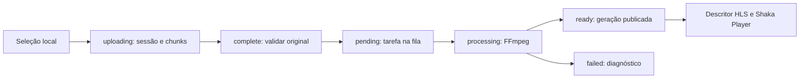

# Vídeos no WebRad: SDK RestGo, upload e Shaka Player

**Data de referência:** 12/10/2026.

**Situação:** documentação e proposta para implementação futura. Nenhuma API ou componente de vídeo do WebRad é implementado por este documento.

## 1. Objetivo e limites

Preparar a integração do módulo nativo de vídeos do RestGo com o WebRad por meio de:

1. Um serviço tipado de vídeos em `@webrad/restgo-sdk`, acessível pelo cliente compartilhado `RestGO`.
2. Um componente **não visual** com seleção de arquivo, upload resumível, progresso, pausa, retomada, cancelamento e acompanhamento do processamento.
3. Um componente **visual** de reprodução usando [Shaka Player](https://github.com/shaka-project/shaka-player), com HLS do RestGo, adaptação automática de qualidade e seleção manual das variantes disponíveis.

Os contratos HTTP abaixo foram consultados no checkout `C:\GitHub\RestGo`. Os nomes `RestGO.videos`, `RestGoVideosClient`, `WebVideoUpload` e `WebVideoPlayer`, seus membros e os exemplos de uso são **propostas**, ainda inexistentes no WebRad. Os nomes públicos do backend, como `descri`, `sizeBytes` e `maxChunkBytes`, devem ser preservados.

YouTube fica fora desta proposta: a condição de suporte pela própria biblioteca Shaka não foi atendida. A evidência e a alternativa oficial estão na seção 9.

## 2. Fontes consultadas e pontos de entrada

### RestGo

| Arquivo em `C:\GitHub\RestGo`           | Conhecimento relevante                                                                                     |
| --------------------------------------- | ---------------------------------------------------------------------------------------------------------- |
| `cmd/api/videos.go`                     | Rotas, autorização por dono, metadados, sessões/chunks, finalização, descritor e entrega de HLS/thumbnail. |
| `cmd/api/videos_media.go`               | Tipos de fonte/variante, FFprobe, seleção de resoluções, FFmpeg e validação da mídia produzida.            |
| `cmd/api/videos_queue.go`               | Fila persistente, tentativas, cancelamento, processamento/reprocessamento e publicação de gerações.        |
| `cmd/api/videos_settings.go`            | Configuração global e validação dos limites.                                                               |
| `migrations/000053_create_videos.sql`   | Tabelas, estados persistentes e configuração inicial.                                                      |
| `cmd/api/cors.go`                       | CORS, preflight e exposição de `Upload-Offset`.                                                            |
| `web/docs.html`, seção `#videos`        | Referência HTTP e exemplos para clientes e players. A página servida é `/docs#videos`.                     |
| `web/app.videos.js`                     | Cliente atual do painel: seleção, chunks de 8 MiB, SHA-256 e consulta do offset para retomada.             |
| `README.md`, seção “Vídeos / Streaming” | Operação, formatos, limites, armazenamento, permissões e referências de testes.                            |

### WebRad existente

| Arquivo ou pacote                                                                                                                        | Como aproveitar na implementação futura                                                          |
| ---------------------------------------------------------------------------------------------------------------------------------------- | ------------------------------------------------------------------------------------------------ |
| [packages/restgo-sdk/src/client.ts](packages/restgo-sdk/src/client.ts)                                                                   | Acrescentar o serviço de vídeos ao cliente que já expõe `auth`, `storage` e `api`.               |
| [packages/restgo-sdk/src/transport.ts](packages/restgo-sdk/src/transport.ts)                                                             | Compartilhar base URL, sessão, renovação, erros e cancelamento; adaptar o envio binário.         |
| [packages/restgo-sdk/src/upload-transport.ts](packages/restgo-sdk/src/upload-transport.ts)                                               | Reutilizar a medição real de upload onde aplicável.                                              |
| [packages/runtime/src/restgo.ts](packages/runtime/src/restgo.ts)                                                                         | Reutilizar o cliente único do projeto e a fachada `RestGO`.                                      |
| [packages/runtime/src/file-upload.ts](packages/runtime/src/file-upload.ts), [docs/file-upload.md](docs/file-upload.md)                   | Referência existente de componente não visual e separação entre `OpenFile()` e `SendToRestGO()`. |
| `packages/project-model`, `packages/component-registry`, `packages/designer`                                                             | Persistência, validação, registro, Inspector e representação no Designer.                        |
| `packages/language`                                                                                                                      | Instâncias concretas, eventos e declarações para Monaco.                                         |
| [packages/compiler/src/bundle.ts](packages/compiler/src/bundle.ts), [scripts/sync-runtime-sources.mjs](scripts/sync-runtime-sources.mjs) | Integração da dependência Shaka e sincronização das fontes/declarações geradas.                  |

O SDK atual ainda não expõe `videos`. O `WebFileUpload` atual envia arquivos comuns por multipart para `/storage/files`; isso não cria um vídeo na biblioteca `/videos`, não gera HLS e não substitui o protocolo resumível do módulo.

## 3. O que o backend já oferece

O RestGo recebe arquivos **MP4, MOV, MKV e WebM**, inspeciona o conteúdo com FFprobe e produz **HLS VOD em H.264/AAC**, com playlists `.m3u8` e segmentos MPEG-TS `.ts`. Extensão aceita no seletor não garante validade: o servidor valida a mídia real na finalização.

A configuração inicial habilita 720p, 1080p e 1440p, limita a 30 FPS e preserva proporção, rotação e taxa fracionária. Não há aumento artificial de resolução/FPS; uma fonte abaixo da menor qualidade habilitada falha. Um vídeo sem áudio não recebe áudio artificial. O termo 2K no backend corresponde a 1440p/QHD.

O backend tem biblioteca, metadados, tarefas, gerações publicadas e thumbnail JPEG opcional. O painel atual permite gerenciar vídeos e enviar arquivos, mas não contém um player. A reprodução será responsabilidade da aplicação WebRad gerada.

| Configuração inicial                    | Valor / efeito                                                     |
| --------------------------------------- | ------------------------------------------------------------------ |
| `maxUploadBytes`                        | 2 GiB por vídeo; configurável pelo administrador.                  |
| `maxStorageBytes`                       | 10 GiB para o módulo de vídeos, com quota própria.                 |
| `maxChunkBytes`                         | 64 MiB por chunk, informado na sessão; respeitar o valor recebido. |
| `uploadTTLHours`                        | 24 horas; chunks confirmados renovam a validade da sessão aberta.  |
| `uploadsEnabled`, `automaticProcessing` | `true`.                                                            |
| `keepOriginal`, `thumbnailEnabled`      | `true`.                                                            |
| `allowPublic`                           | `false`: publicar exige habilitação administrativa no servidor.    |
| `maxConcurrent`, `threadsPerJob`        | 1 conversão simultânea, 2 threads por tarefa.                      |
| `timeoutSeconds`, `maxAttempts`         | 21600 segundos e 3 tentativas de processamento.                    |

Configuração é persistida no PostgreSQL, e cada tarefa captura um snapshot. Ela pertence ao servidor; propriedades do componente não devem fingir alterar resoluções ou limites globais. Habilitar o processamento automático depois não inicia tarefas cujo snapshot o desabilitou; essas tarefas precisam da operação `process`.

Não há neste contrato upload multipart de vídeos, protocolo tus, envio de URL para importar mídia, links assinados, download público do original, streaming ao vivo ou publicação DASH pelo RestGo. O HLS privado usa autorização HTTP; isso não equivale a DRM.

### Estados e disponibilidade



- Vídeo: `uploading`, `pending`, `processing`, `ready`, `failed`, `deleting`.
- Sessão de upload: `open`, `completed`, `cancelled`.
- Tarefa: `pending`, `processing`, `ready`, `failed`, `cancelled`.
- `video.progress` é aproximado e pode ser `null`; não é o offset confirmado do upload.
- `complete` confirma o original e enfileira; sua resposta não garante um vídeo reproduzível.
- Durante reprocessamento, uma geração anterior pode continuar disponível. O descritor depende de uma geração publicada, não exclusivamente do estado `ready`.
- Uma falha de reprocessamento preserva a geração válida; o vídeo pode voltar a `ready` com diagnóstico em `error`/`jobs`. Gerações substituídas são retidas por 24 horas sob a autorização atual.
- `deleting` suspende acesso e aparece como 404 nas consultas individuais. Exclusão/cancelamento aceitos com 202 podem exigir limpeza posterior.

## 4. Contrato HTTP que o SDK deve representar

As rotas são nativas, sem prefixo de API dinâmica `/v{versao}/{banco}/...`. Sucesso retorna objeto JSON direto; erros usam `{"error":"mensagem"}`. O SDK deve adaptar isso ao `RestGoResult<T>` existente, sem inventar um envelope `success/data` no backend.

### Autenticação

No navegador, usar `Authorization: Bearer <JWT>` de **Authentication**, obtido pelo fluxo existente de `RestGO.login()` e renovação de sessão. Esse usuário gerencia somente seus próprios vídeos. Um vídeo privado é acessível ao dono ou ao administrador; não há compartilhamento com outros usuários definido nessas rotas.

Master, JWT do painel e tokens de API administrativos são aceitos pelo servidor para administração. Essas credenciais devem permanecer no contexto administrativo da IDE/servidor e nunca entrar no Project Model exportável, componente, player ou bundle público. Token de API comum não autoriza o módulo de vídeos.

Somente o descritor HLS, as playlists/segmentos e a thumbnail de vídeos públicos dispensam autenticação. `/videos`, `/videos/{id}` e sessões de upload continuam protegidos mesmo quando `isPublic` é `true`. Conhecer um ID ou uma URL privada não concede acesso. O servidor ignora tokens em query; não criar `?token=...` como solução.

### Upload resumível

| Método e rota                              | Entrada e resposta                                                           | Observações                                                                                                                                                               |
| ------------------------------------------ | ---------------------------------------------------------------------------- | ------------------------------------------------------------------------------------------------------------------------------------------------------------------------- |
| `POST /videos/uploads`                     | JSON `{filename,sizeBytes,title?,descri?,isPublic?,ownerId?}` → sessão; 201. | `filename` sem caminho, até 255 bytes; título até 200 bytes, descrição até 4000 bytes. Título omitido/vazio usa o nome sem extensão. Só administrador escolhe outro dono. |
| `GET /videos/uploads/{uploadId}`           | Sessão e header `Upload-Offset`; 200.                                        | A posição do servidor é a fonte de verdade para retomada. A consulta pode retornar uma sessão aberta já expirada antes da limpeza assíncrona.                             |
| `PUT /videos/uploads/{uploadId}/chunks`    | Body binário, headers descritos abaixo → sessão atualizada; 200.             | Sequencial, checksum obrigatório, até `maxChunkBytes` e sem ultrapassar o tamanho declarado.                                                                              |
| `POST /videos/uploads/{uploadId}/complete` | Sem body → registro do vídeo.                                                | 202 na primeira finalização; 200 nas repetições de sessão concluída, sem duplicar vídeo/tarefa.                                                                           |
| `DELETE /videos/uploads/{uploadId}`        | Sem body → `{status:"deleting"}`; 202.                                       | Cancela sessão aberta e agenda exclusão. Sessão concluída retorna 409; para excluir o vídeo concluído usar `/videos/{videoId}`.                                           |

Exemplo de criação:

```json
{
  "filename": "aula.mp4",
  "sizeBytes": 10485760,
  "title": "Aula 1",
  "descri": "Introdução",
  "isPublic": false
}
```

Exemplo de sessão, com IDs e data ilustrativos:

```json
{
  "id": "uuid-sessao",
  "videoId": "uuid-video",
  "offset": 0,
  "sizeBytes": 10485760,
  "state": "open",
  "expiresAt": "2026-10-13T12:00:00Z",
  "maxChunkBytes": 67108864
}
```

Cada chunk deve enviar:

```http
Content-Type: application/octet-stream
Authorization: Bearer <JWT-do-dono>
Upload-Offset: <posição-confirmada-em-bytes>
Upload-Checksum: <SHA-256-do-chunk-em-64-caracteres-hexadecimais>
```

O checksum é hexadecimal puro, sem prefixo `sha256` e sem Base64. Não enviar `FormData`, JSON ou `Content-Range` no lugar desses headers. O offset só avança depois da validação do checksum e gravação confirmada pelo servidor.

### Biblioteca e processamento

| Método e rota                      | Entrada / resposta                                                                                                                                                           |
| ---------------------------------- | ---------------------------------------------------------------------------------------------------------------------------------------------------------------------------- |
| `GET /videos`                      | Query `limit` 1–100 (padrão 25), `offset` ≥ 0, `q`, `status`, `ownerId` administrativo → `{data:Video[],total,limit,offset}`. Não usar paginação `page/pageSize` do Storage. |
| `GET /videos/{videoId}`            | `{video,jobs}`; até dez tarefas recentes, com snapshot, tentativas e diagnóstico.                                                                                            |
| `PUT /videos/{videoId}`            | Objeto completo `{title,descri,isPublic}` → vídeo atualizado. Não tratar como PATCH parcial.                                                                                 |
| `POST /videos/{videoId}/process`   | Sem body → `{id,jobId,status:"pending"}`; 202. Processa tarefa pendente manualmente ou cria tentativa quando possível.                                                       |
| `POST /videos/{videoId}/reprocess` | Sem body → `{id,jobId,status:"pending"}`; 202. Captura configuração atual, preservando versão publicada até a troca atômica.                                                 |
| `POST /videos/{videoId}/cancel`    | Sem body → `{id,state:"cancelled"}`; 202. Cancela tarefa ativa, preservando original/versão publicada.                                                                       |
| `DELETE /videos/{videoId}`         | Sem body → `{id,status:"deleting"}`; 202. Exclui vídeo, original e gerações por limpeza recuperável.                                                                         |

`process`/`reprocess` exigem original preservado e rejeitam tarefas conflitantes com 409. Cancelar uma tarefa de processamento e cancelar uma sessão de upload são operações diferentes.

### Reprodução

| Método e rota                                                            | Resposta / comportamento                                                                                  |
| ------------------------------------------------------------------------ | --------------------------------------------------------------------------------------------------------- |
| `GET /videos/{videoId}/hls`                                              | `{id,title,isPublic,masterUrl,thumbnailUrl,variants,duration,authentication}`; 409 sem geração publicada. |
| `GET /videos/{videoId}/thumbnail`                                        | JPEG opcional; também HEAD/Range. 404 quando indisponível.                                                |
| `GET /videos/{videoId}/hls/{generationId}/master.m3u8`                   | Playlist master; MIME `application/vnd.apple.mpegurl`.                                                    |
| `GET /videos/{videoId}/hls/{generationId}/{qualidade}/index.m3u8`        | Playlist de variante existente, como `720p`.                                                              |
| `GET /videos/{videoId}/hls/{generationId}/{qualidade}/segment_000000.ts` | Segmento existente; MIME `video/mp2t`.                                                                    |

Playlists e segmentos também aceitam HEAD/Range. Recursos usam `private, no-store`, `nosniff` e autorização atual a cada requisição, inclusive para gerações antigas. Não adicionar cache persistente/offline que torne um vídeo acessível após revogação de permissões.

`thumbnailUrl` pode vir no descritor mesmo sem thumbnail disponível; tratar 404 como ausência de poster. `authentication` é texto informativo do servidor, não um token nem um valor de header.

### Configuração administrativa

`GET /videos/settings` lê a configuração completa; `PUT /videos/settings` substitui o objeto completo, rejeitando campos desconhecidos. Acesso é administrativo; usuário comum recebe 403. O player e o componente de upload devem funcionar sem acessar essas rotas. Uma futura edição dessas opções pertence ao workspace administrativo do RestGo na IDE.

### Erros que precisam de tratamento próprio

| Status / condição        | Tratamento esperado                                                                                                 |
| ------------------------ | ------------------------------------------------------------------------------------------------------------------- |
| 400                      | Entrada, checksum ou mídia inválidos. Corrigir a causa; não repetir indefinidamente.                                |
| 401                      | Usar o fluxo compartilhado de renovação/login; limitar tentativas.                                                  |
| 403                      | Sem permissão, uploads bloqueados ou publicação pública bloqueada. Não substituir por credencial administrativa.    |
| 404                      | Recurso ausente, removido ou já em exclusão; thumbnail ausente é caso opcional.                                     |
| 409 no chunk             | Offset divergente ou operação concorrente. Consultar sessão, aguardar se necessário e retomar do offset confirmado. |
| 409 em `complete`        | Upload incompleto/integridade divergente; verificar sessão/arquivo.                                                 |
| 409 em HLS               | Sem geração publicada; distinguir processamento pendente de falha.                                                  |
| 409 em processamento     | Conflito, encerramento em andamento ou falta de original.                                                           |
| 410                      | Sessão expirada; informar e iniciar outra sessão por ação explícita.                                                |
| 413                      | Arquivo/chunk além do limite; não resolver com repetição idêntica.                                                  |
| 507                      | Quota/disco insuficientes; manter diagnóstico sem simular conclusão.                                                |
| 429, 5xx e falha de rede | Tentativas limitadas, espera progressiva e `Retry-After` quando presente; reconciliar upload antes de reenviar.     |

## 5. Estrutura proposta do SDK

Criar `RestGoVideosClient` em módulo próprio de `packages/restgo-sdk`, sem dependência de Shaka ou DOM visual. Expor a instância como `client.videos` e `RestGO.videos`, reutilizando transporte e autenticação existentes. O SDK retorna `{data,error}`; os componentes podem seguir a convenção existente de Promise com rejeição e eventos tipados.

### Tipos públicos

O seguinte trecho é uma proposta de tipos para os principais retornos HTTP. Datas JSON são strings; propriedades `ownerId` e `generation` podem estar ausentes. A fonte antes da inspeção pode conter valores iniciais zero/vazios.

```ts
type RestGoVideoStatus = 'uploading' | 'pending' | 'processing' | 'ready' | 'failed' | 'deleting';

type RestGoVideoJobState = 'pending' | 'processing' | 'ready' | 'failed' | 'cancelled';
type RestGoVideoUploadState = 'open' | 'completed' | 'cancelled';

interface RestGoVideoUploadSession {
  id: string;
  videoId: string;
  offset: number;
  sizeBytes: number;
  state: RestGoVideoUploadState;
  expiresAt: string;
  maxChunkBytes: number;
}

interface RestGoVideoSource {
  width: number;
  height: number;
  codedWidth: number;
  codedHeight: number;
  rotation: number;
  fps: number;
  frameRate: string;
  duration: number;
  format: string;
  codec: string;
  hasAudio: boolean;
  audioCodec?: string;
  videoStream: number;
  audioStream: number;
  level: number;
}

interface RestGoVideoVariant {
  quality: number;
  width: number;
  height: number;
  fps: number;
  frameRate: string;
  bandwidth: number;
  averageBandwidth: number;
  codecs: string;
}

interface RestGoVideo {
  id: string;
  ownerId?: string;
  title: string;
  descri: string;
  isPublic: boolean;
  sizeBytes: number;
  source: RestGoVideoSource;
  originalRetained: boolean;
  status: RestGoVideoStatus;
  progress: number | null;
  error: string;
  generation?: string;
  variants: RestGoVideoVariant[];
  hasThumbnail: boolean;
  createdAt: string;
  updatedAt: string;
}

interface RestGoVideoSettings {
  resolutions: (720 | 1080 | 1440)[];
  maxFPS: 30 | 60;
  quality: 'high' | 'balanced' | 'economy' | 'custom';
  crf: number;
  preset: 'fast' | 'medium' | 'slow';
  maxrateKbps: Record<'720' | '1080' | '1440', number>;
  automaticBuffer: boolean;
  bufsizeKbps: Record<'720' | '1080' | '1440', number>;
  audioKbps: 96 | 128 | 192 | 256;
  uploadsEnabled: boolean;
  automaticProcessing: boolean;
  maxUploadBytes: number;
  maxStorageBytes: number;
  maxConcurrent: number;
  keepOriginal: boolean;
  thumbnailEnabled: boolean;
  allowPublic: boolean;
  threadsPerJob: number;
  timeoutSeconds: number;
  maxAttempts: number;
  uploadTTLHours: number;
}

interface RestGoVideoJob {
  id: string;
  state: RestGoVideoJobState;
  attempts: number;
  options: RestGoVideoSettings;
  error: string;
  createdAt: string;
  startedAt: string | null;
  finishedAt: string | null;
}

interface RestGoVideoDetails {
  video: RestGoVideo;
  jobs: RestGoVideoJob[];
}

interface RestGoVideoList {
  data: RestGoVideo[];
  total: number;
  limit: number;
  offset: number;
}

interface RestGoVideoHlsDescriptor {
  id: string;
  title: string;
  isPublic: boolean;
  masterUrl: string;
  thumbnailUrl: string;
  variants: RestGoVideoVariant[];
  duration: number;
  authentication: string;
}
```

Definir também entradas de criação/edição, respostas de operações 202, opções com `AbortSignal` e eventos de progresso. Validar offsets/tamanhos como inteiros seguros, limites e respostas em runtime; um cast TypeScript não confirma integridade do JSON. Preservar campos recebidos e acrescentar URLs absolutas em campos distintos, sem sobrescrever `masterUrl`/`thumbnailUrl` originais.

### API proposta

Os membros abaixo pertencem a `RestGO.videos`; todos os métodos de rede aceitam cancelamento e retornam `Promise<RestGoResult<T>>` com o tipo correspondente.

| Membro proposto                                                                                     | Responsabilidade                                                                                              |
| --------------------------------------------------------------------------------------------------- | ------------------------------------------------------------------------------------------------------------- |
| `uploads.create(input, options?)`                                                                   | Criar sessão com metadados e tamanho; opções comuns do navegador não precisam de `ownerId`.                   |
| `uploads.get(uploadId, options?)`                                                                   | Obter estado/offset/validade confirmados.                                                                     |
| `uploads.sendChunk(uploadId, chunk, options)`                                                       | Enviar binário com offset/checksum; expor progresso real opcional.                                            |
| `uploads.complete(uploadId, options?)`                                                              | Finalizar idempotentemente e retornar `RestGoVideo`.                                                          |
| `uploads.cancel(uploadId, options?)`                                                                | Cancelar sessão no servidor; operação destrutiva explícita.                                                   |
| `upload(file, options?)`                                                                            | Orquestrar criação, chunks e finalização; retornar o vídeo confirmado, sem esperar conversão automaticamente. |
| `resumeUpload(uploadId, file, options?)`                                                            | Consultar sessão existente e continuar sem criar outro vídeo.                                                 |
| `list(options?)`, `get(videoId, options?)`                                                          | Biblioteca paginada e detalhes/tarefas.                                                                       |
| `update(videoId, input, options?)`, `remove(videoId, options?)`                                     | Metadados completos e exclusão.                                                                               |
| `process(videoId, options?)`, `reprocess(videoId, options?)`, `cancelProcessing(videoId, options?)` | Operações de tarefa, distintas de cancelar upload.                                                            |
| `getHls(videoId, options?)`                                                                         | Descritor; permitir consulta explicitamente pública sem exigir sessão local.                                  |
| `getThumbnail(videoId, options?)`                                                                   | `Blob` com a política público/privado correspondente.                                                         |
| `waitUntilReady(videoId, options?)`                                                                 | Consulta periódica cancelável com intervalo/timeout, callbacks tipados e término em falha.                    |

`waitUntilReady` é uma conveniência proposta, não um endpoint nem assinatura realtime. Para acompanhar um reprocessamento específico, observar também a tarefa/generation alvo: a existência de uma versão antiga não comprova sucesso da nova tarefa. Não esperar indefinidamente quando o processamento automático estiver desabilitado.

### Ajuste necessário no transporte existente

Hoje `RestGoTransport.request()` trata `FormData`/`Blob` removendo `Content-Type` e serializa outros bodies como JSON. Antes de utilizá-lo para vídeo, adicionar suporte explícito a body binário e preservação de `application/octet-stream`. A decisão deve manter o boundary automático do multipart existente. Passar um `ArrayBuffer` pelo comportamento atual produziria uma requisição inadequada.

Compartilhar renovação e controle de sessão; não criar uma autenticação paralela para vídeos. Em chunks, repetição após 401/falha de conexão deve consultar o offset, pois a requisição anterior pode ter sido gravada apesar de o cliente não ter recebido a resposta. `POST /videos/uploads` não tem chave de idempotência documentada: não repetir cegamente uma criação com resultado incerto. Já `complete` pode ser reconciliado/repetido pelo mesmo ID de sessão.

## 6. Algoritmo de envio e retomada

1. Selecionar arquivo por interação do usuário, mantendo-o como `File` em memória. Essa ação não cria sessão nem envia bytes.
2. Validar extensão, tamanho e metadados locais; autenticar usando o cliente compartilhado.
3. Criar sessão somente ao executar envio. Guardar `uploadId` e `videoId` separadamente.
4. Ler a posição confirmada antes de começar/retomar. Rejeitar estado encerrado, offset incoerente e tamanho incompatível; sessão `completed` permite recuperar o vídeo sem reenviar.
5. Usar chunks sequenciais de tamanho sugerido 8 MiB, limitado por `maxChunkBytes` e pelos bytes restantes. Não carregar o vídeo completo em um `ArrayBuffer`.
6. Calcular SHA-256 do chunk com Web Crypto em contexto compatível e enviá-lo com offset/checksum. Falhar com mensagem clara se a capacidade necessária não existir.
7. Atualizar bytes **confirmados** somente pela resposta do servidor. Em falha de rede/409, consultar a sessão e reconciliar antes de repetir.
8. Após `offset === sizeBytes`, chamar `complete`. Expor sucesso de envio/aceitação do original separadamente de conclusão do processamento.
9. Se solicitado pelo código da aplicação, acompanhar detalhes com intervalo inicial de 1–3 segundos e espera progressiva em falhas transitórias. Oferecer timeout/cancelamento.
10. Quando houver geração publicada, consultar o descritor HLS e passá-lo ao componente visual pelo ID do vídeo.

### Progresso, pausa e cancelamento

- Distinguir `confirmedBytes`, `totalBytes`, porcentagem confirmada e medição transitória do chunk atual. O corpo enviado por XHR ainda não equivale a dados confirmados pelo servidor.
- Progresso de rede pode ser indeterminado; usar `null` e o indicador correspondente, sem porcentagens intermediárias simuladas. Em retomada/repetição, recalcular a partir da confirmação.
- **Pausar** interrompe a requisição local e preserva a sessão; não chama DELETE. O próximo envio consulta o offset antes de retomar.
- **Cancelar upload** chama DELETE da sessão aberta e agenda a exclusão no servidor. Abortar a requisição local por `AbortSignal` não comprova cancelamento remoto.
- **Cancelar processamento** chama `/videos/{videoId}/cancel`; não remove o vídeo nem a versão publicada.
- Descartar um componente/página interrompe I/O e observadores locais, sem apagar automaticamente vídeos/sessões do servidor.
- Não iniciar dois envios simultâneos para a mesma sessão. A API pública deve definir se uma segunda chamada compartilha a operação existente ou retorna conflito; a opção sugerida é compartilhar a Promise do envio ativo, como no `WebFileUpload`.

### Retomada depois de fechar a aplicação

O navegador normalmente exige selecionar novamente o arquivo; não prometer acesso posterior por caminho absoluto. Guardar um descritor de retomada serializável com servidor/base URL, usuário dono, IDs, nome, tamanho e `lastModified`, sem credenciais. Esses dados não devem contaminar o Project Model de design com estado transitório de execução.

Nome/tamanho/data são verificações de identidade preliminares e não provam que o conteúdo seja o mesmo. O backend recebe hashes por chunk, mas não fornece uma identidade global do arquivo original para retomada. Uma implementação que prometa verificação forte deve definir e validar uma impressão do conteúdo calculada por partes; não aceitar silenciosamente outro arquivo de mesmo tamanho. Troca de servidor, logout ou troca de usuário deve invalidar/suspender a associação local de retomada.

## 7. Componente não visual proposto: `WebVideoUpload`

Classe real de runtime, seguindo a base não visual existente, registrada na paleta/bandeja **Nonvisual**. Sua responsabilidade é selecionar e enviar vídeos pelo serviço SDK; a conversão ocorre no RestGo.

| Categoria                | Proposta                                                                                                                                     |
| ------------------------ | -------------------------------------------------------------------------------------------------------------------------------------------- |
| Configuração persistente | `accept` (padrão `.mp4,.mov,.mkv,.webm`), `title`, `descri`, `isPublic` (padrão `false`), `chunkSizeBytes` (sugestão 8 MiB).                 |
| Estado somente leitura   | `selection`, `uploadSession`, `video`, `state`, `confirmedBytes`, `totalBytes`, `percentage`, `processingProgress`, `error`.                 |
| Métodos                  | `OpenFile()`, `SendToRestGO(options?)`, `Pause()`, `Resume(options?)`, `CancelUpload()`, `WaitUntilReady(options?)`, `Clear()`, `dispose()`. |
| Eventos tipados          | `OnChange`, `OnProgress`, `OnStateChange`, `OnUploadComplete`, `OnProcessingProgress`, `OnReady`, `OnError`, `OnComplete`.                   |

`selection` deve expor nome, tamanho, extensão e `path: string | null`, como o componente existente, sem caminho fictício. Cancelar o seletor retorna `null` e preserva uma seleção anterior. `Clear()` limpa o estado local quando permitido e não exclui dados remotos.

O estado local deve distinguir seleção, hashing, envio, pausa, finalização e acompanhamento; não reutilizar `video.status` para tudo. Eventos usam `sender: WebVideoUpload` e `CustomEvent<DetalheTipado>` no padrão do runtime. Cada operação terminal deve emitir eventos uma única vez. `OnUploadComplete` significa finalização aceita pelo servidor; `OnReady` significa disponibilidade confirmada; `OnComplete` encerra a operação correspondente com seu resultado/erro, sem confundir essas fases.

`SendToRestGO()` deve aceitar sobrescritas de título/descrição/visibilidade e `signal`, e retornar o registro do vídeo confirmado. O acompanhamento até reprodução é uma chamada explícita. Upload não deve abrir o player automaticamente.

## 8. Componente visual proposto: `WebVideoPlayer`

Classe real baseada em `WebComponent`, com elemento `<video>` encapsulado e instância própria de Shaka. A biblioteca suporta HLS e DASH em navegadores compatíveis; o fluxo RestGo desta proposta fornece HLS. Reprodução depende também de codecs e capacidades do navegador. [Fonte: projeto Shaka](https://github.com/shaka-project/shaka-player).

| Categoria              | Proposta                                                                                                                                                          |
| ---------------------- | ----------------------------------------------------------------------------------------------------------------------------------------------------------------- |
| Fonte persistente      | `source`: união discriminada `{kind:'restgo',videoId:string}` ou `{kind:'url',url:string,format:'hls'                                                             | 'dash'}`. Não persistir JWT nem descritor com geração temporária. |
| Configuração           | `controls`, `autoplay` (padrão `false`), `muted`, `loop`, `playsInline`, `volume`, `playbackRate`, `objectFit`, `quality` (`'auto'` por padrão), poster opcional. |
| Estado somente leitura | `state`, `duration`, `currentTime`, `buffered`, `availableQualities`, `currentQuality`, `isPlaying`, `error`.                                                     |
| Métodos                | `LoadRestGo(videoId, options?)`, `LoadUrl(url, options?)`, `Play()`, `Pause()`, `Stop()`, `Seek(seconds)`, `SetQuality(value)`, `Unload()`, `dispose()`.          |
| Eventos tipados        | `OnLoaded`, `OnPlay`, `OnPause`, `OnEnded`, `OnTimeUpdate`, `OnBuffering`, `OnQualityChange`, `OnError`.                                                          |

`Play()` deve permitir ao código tratar rejeição por política de autoplay. `Stop()` pausa e volta ao início, preservando a fonte carregada; `Unload()` descarrega a mídia. Métodos assíncronos devem expor conclusão real. O componente usa os contratos de layout/estilo existentes e deve preservar proporção, foco, acessibilidade e responsividade.

A fonte URL é uma possibilidade proposta para mídia direta compatível, sem enviar automaticamente credenciais RestGo. Uma URL de página web, como `youtube.com/watch`, não equivale a uma URL de manifesto. Manter o SDK de upload independente da biblioteca visual.

### Integração do Shaka

Usar configuração programática por instância (`shaka.Player`, `attach()` e `load()`), com listeners registrados antes do carregamento. Para controles, usar `shaka.ui.Overlay` e o CSS distribuído com a mesma versão da biblioteca. A configuração programática evita depender de descoberta global do DOM em páginas/reutilizáveis. [Uso básico](https://shaka-project.github.io/shaka-player/docs/api/tutorial-basic-usage.html), [UI Library](https://shaka-project.github.io/shaka-player/docs/api/tutorial-ui.html).

Fixar uma versão estável na futura dependência/lockfile, validar sua API e manter os avisos da licença Apache-2.0. A versão não foi escolhida nem instalada nesta etapa. Incluir JavaScript, CSS e eventuais workers/assets necessários tanto no Preview quanto na aplicação exportada, com caminhos portáveis e suporte a prefixos de hospedagem. O bundler atual possui fontes virtuais para runtime/SDK: instalar o npm package na IDE, isoladamente, não demonstra que a exportação conseguirá resolver o Shaka.

Encapsular a biblioteca em um adaptador tipado. Componentes devem ser referenciados por `VideoPlayer1` e `this.VideoPlayer1`, sem `any`, globais Shaka expostos como API do usuário ou acesso obrigatório ao DOM. Troca de fonte deve cancelar a carga anterior e impedir que respostas antigas sobrescrevam a fonte atual.

Descarte deve remover filtros/listeners, interromper requisições, destruir player/overlay, revogar URLs de Blob e encerrar observadores. Confirmar a responsabilidade de destruição do overlay/player na versão escolhida para evitar destruir a mesma instância duas vezes.

### Autorização de HLS privado

1. Buscar o descritor pelo SDK autenticado e resolver suas URLs.
2. Instalar filtro de rede no Shaka **antes** de carregar. `NetworkingEngine.registerRequestFilter()` permite ajustar headers e admite filtros assíncronos. [NetworkingEngine](https://shaka-project.github.io/shaka-player/docs/api/shaka.net.NetworkingEngine.html), [autenticação e filtros](https://shaka-project.github.io/shaka-player/docs/api/tutorial-license-server-auth.html).
3. Inserir o JWT atual em master, playlists de variantes e segmentos privados, inclusive nas novas tentativas. Validar origem **e caminho do módulo/base configurada** de todas as URIs antes de acrescentar Authorization. Não encaminhar a credencial a URL externa, anúncio ou outro serviço.
4. Reutilizar a sessão e renovação centralizadas, evitando capturar um JWT fixo no primeiro carregamento. Como as requisições Shaka não passam automaticamente por `RestGoTransport`, criar uma ponte interna explícita com esse fluxo.
5. Em 401, renovar uma vez de forma coordenada e refazer a operação/recarregar preservando posição quando viável. Em 403, parar com erro de acesso; não entrar em loop de refresh. Revalidar logout/troca de usuário.
6. Carregar poster privado pelo SDK como `Blob` e usar URL de objeto revogável; o atributo `poster` não injeta Authorization. Ausência de thumbnail não impede reprodução.

Não colocar o JWT no Project Model, URL, HTML exportado ou mensagens/logs. Aplicações com apenas vídeos públicos devem poder obter o descritor e reproduzir sem login. A visibilidade pode mudar durante a reprodução: tratar a rejeição das próximas requisições e limpar dados locais sob controle do componente.

### URLs, proxy e CORS

O backend retorna caminhos como `/videos/{id}/hls/{generation}/master.m3u8`, relativos à instância. Se a conexão for `https://api.exemplo.com/restgo`, a URL esperada é `https://api.exemplo.com/restgo/videos/...`. `new URL('/videos/...', baseUrl)` descartaria `/restgo`; usar um resolvedor comum que preserve o prefixo, como já faz o transporte SDK para rotas nativas. Preservar os caminhos relativos internos das playlists para a resolução pelo Shaka.

Validar protocolo HTTP(S), origem e escopo antes de acrescentar credencial. Rejeitar URLs inesperadas/redirecionamentos na integração autenticada e configurar a URL final da instância. Hooks de rede não devem ser tratados como prova de segurança de redirecionamentos: testar também o transporte efetivamente usado pela versão Shaka.

O CORS atual do RestGo aceita origens HTTP(S), permite os headers de upload/autorização e expõe `Upload-Offset`; não habilita cookies cross-origin. Usar `credentials:'omit'` no SDK e não habilitar `allowCrossSiteCredentials` no Shaka. Verificar preflight para `Authorization`, `Upload-Offset`, `Upload-Checksum` e Range quando utilizado. Preview deve usar sua origem HTTP compatível; não assumir que `file://`/origem `null` será aceita.

Página HTTPS exige manifesto/segmentos HTTPS. Configurar tempo limite, tentativas e buffers de forma limitada; as opções de manifesto e segmentos do Shaka são distintas. [Rede, buffering e requisitos do servidor](https://shaka-project.github.io/shaka-player/docs/api/tutorial-network-and-buffering-config.html).

### Safari/iOS e reprodução nativa

O próprio elemento `<video src="...">` não oferece um hook para inserir Authorization em cada requisição de HLS. Quando o Shaka usa o caminho nativo, seu filtro de rede não deve ser considerado suficiente para proteger esse fluxo. Identificar suporte MSE/MMS e o modo realmente usado na versão selecionada. A matriz do Shaka distingue reprodução nativa e capacidades por plataforma. [Matriz oficial](https://github.com/shaka-project/shaka-player#platform-and-browser-support-matrix).

Vídeos públicos podem usar reprodução nativa compatível. Para privados, escolher o caminho Shaka que efetivamente transporte o header em todas as requisições e comprová-lo no navegador. Quando isso não for possível, informar incompatibilidade de reprodução privada nesse ambiente. Não prometer suporte universal nem converter a fonte para pública como fallback. Uma solução por links assinados/cookies exigiria outro contrato de backend.

### Qualidade e controles

Oferecer `Auto` e somente as qualidades presentes no descritor/manifesto e reproduzíveis pelo navegador. A UI Shaka permite controle de ABR/resolução. Seleção manual usa uma track obtida por `getVariantTracks()`, desativa ABR e chama `selectVariantTrack()`; voltar a `Auto` reativa ABR. [Configuração da UI](https://shaka-project.github.io/shaka-player/docs/api/tutorial-ui-customization.html), [API do Player](https://shaka-project.github.io/shaka-player/docs/api/shaka.Player.html#selectVariantTrack).

Relacionar a qualidade nominal do RestGo (`quality`) às dimensões/codecs das tracks; em vídeos verticais, não usar apenas `track.height` como rótulo. Mudança solicitada, mudança efetiva e buffering devem ter eventos coerentes. Não oferecer 1080p/1440p se não existirem, nem prometer troca instantânea independente do buffer. Legendas só devem aparecer quando houver trilhas; o módulo RestGo consultado não oferece envio de legendas. Fullscreen/PiP dependem das capacidades e permissões do ambiente.

## 9. YouTube: decisão de compatibilidade

**Não oferecer YouTube como fonte deste componente Shaka.** A [resposta oficial do mantenedor na issue #2418](https://github.com/shaka-project/shaka-player/issues/2418#issuecomment-590423238) informa que conteúdo do YouTube não é suportado e recomenda o player incorporado por iframe. A resposta é histórica; a documentação atual consultada descreve reprodução por manifestos/mídia e não fornece um provedor oficial para links `watch`, `youtu.be` ou ID do YouTube. Essa combinação fundamenta a decisão desta proposta, sujeita a rechecagem futura se o Shaka anunciar outro contrato.

O [YouTube IFrame Player API](https://developers.google.com/youtube/iframe_api_reference) permite incorporar o player oficial, mas seria uma integração separada, com outras capacidades e eventos. Como a solicitação condiciona YouTube ao suporte da biblioteca Shaka, essa alternativa não integra o escopo atual. Não adicionar extração de streams ou adapters de terceiros como se fossem suporte nativo do Shaka.

## 10. Integração com a arquitetura WebRad

| Camada             | Trabalho necessário quando a implementação for autorizada                                                                                                             |
| ------------------ | --------------------------------------------------------------------------------------------------------------------------------------------------------------------- |
| SDK                | Serviço, tipos, validação de respostas, binário, retomada, erros e sessão compartilhada.                                                                              |
| Runtime            | Duas classes reais com propriedades/métodos/eventos e descarte por instância; exports em `@webrad/runtime`.                                                           |
| Project Model      | Configurações versionadas e validadas; não persistir `File`, player, tokens ou progresso. Preservar IDs ao renomear.                                                  |
| Component Registry | Registro central de comportamento/metadata, propriedades do Inspector e eventos; evitar condicionais de tipo dispersas na IDE.                                        |
| Designer           | Bandeja não visual e superfície visual com comportamento de edição previsível. Selecionar o componente não deve disparar envio ou autoplay.                           |
| Linguagem/Monaco   | Tipos concretos, completion, hover, assinaturas e diagnósticos; `ComponentName.member` e `this.ComponentName.member`, com shadowing e isolamento entre reutilizáveis. |
| Compiler/Preview   | Instanciação real, eventos, fontes/declarações sincronizadas, Shaka e CSS/assets resolvidos no bundle e no Preview/F9.                                                |
| IDE administrativa | Somente se houver trabalho específico: configuração de `/videos/settings` pelo canal administrativo tipado, separado do runtime/browser.                              |

Manter TypeScript `strict`, separação runtime/designer e aplicações exportadas independentes de Electron/Node. Mudanças em código TypeScript do usuário exigem AST; não sobrescrever arquivos autorais. Ao implementar, atualizar `PLANS.md` e documentação pertinente de arquitetura/formato persistente. Nesta etapa, a alteração é apenas este documento de referência na raiz.

### Exemplo de uso futuro

Este exemplo depende das APIs propostas acima e ainda **não compila no WebRad atual**. Seleção/envio, conversão e reprodução são chamadas explícitas:

```ts
const selecao = await VideoUpload1.OpenFile();
if (!selecao) return;

const video = await VideoUpload1.SendToRestGO({
  title: 'Aula 1',
  descri: 'Introdução',
  isPublic: false,
});

// Se o servidor não processar automaticamente, iniciar explicitamente:
// const job = await RestGO.videos.process(video.id);
// if (job.error) throw job.error;

await VideoUpload1.WaitUntilReady({ timeoutMs: 10 * 60 * 1000 });
await VideoPlayer1.LoadRestGo(video.id);
await VideoPlayer1.Play();
```

O exemplo pressupõe login prévio para upload/privados e precisa de tratamento de erro/autoplay na aplicação. Qualquer uso via `this.VideoUpload1`/`this.VideoPlayer1` deve ter os mesmos tipos.

## 11. Critérios de aceite da futura implementação

1. **SDK/HTTP:** criação, chunks binários com checksum, finalização idempotente, biblioteca, edição completa, tarefas, HLS, thumbnail, erros e cancelamento; preservar prefixo de proxy.
2. **Retomada:** conexão interrompida, resposta perdida após chunk gravado, 409, refresh, pausa, expiração, arquivo incompatível e reload com nova seleção. Sem vídeo duplicado por retomada e sem atribuir a criação uma idempotência inexistente.
3. **Progresso:** bytes confirmados reais, indeterminação quando necessária, emissão única de eventos e distinção entre envio completo e processamento concluído.
4. **Segurança funcional:** dono, outro usuário, sem login e público; nenhum token administrativo exportado, JWT para todas as playlists/segmentos privados, URLs externas sem credencial, logout e alteração de visibilidade.
5. **Player em navegador real:** execução do bundle compilado no Preview/F9, avanço de tempo, áudio/vídeo quando disponíveis, seek, pausa/fim, Auto/manual, poster privado, mudança de fonte e descarte.
6. **Integração IDE:** serialização/validação, registry, Inspector, histórico, geometria, página/reutilizáveis e instâncias concretas; Monaco completa membros corretos e rejeita usos inválidos.
7. **Portabilidade:** Windows/Linux, aplicação exportada fora da IDE, rede com proxy/prefixo, tamanhos de tela e suporte público/privado documentado conforme navegadores efetivamente testados.
8. **Qualidade:** passar typecheck, lint, testes e build do escopo, além de checagem das fontes geradas. Não declarar execução visual ou HTTP real com base apenas em testes de Node/JSDOM.

Comandos de referência do repositório para a futura etapa de código:

```powershell
npm.cmd run runtime:sources
npm.cmd run runtime:sources:check
npm.cmd run typecheck
npm.cmd run lint
npm.cmd test -- --maxWorkers=4 --minWorkers=1 --reporter=dot
npm.cmd run format:check
npm.cmd run build
```

Esta documentação foi baseada em leitura dos arquivos locais e consulta das fontes oficiais do Shaka/YouTube. Não foi executado smoke HTTP do RestGo nem teste de reprodução nesta etapa; a integração futura permanece pendente. Não é necessário gerar release/instalador ou alterar versão para produzir este documento.
