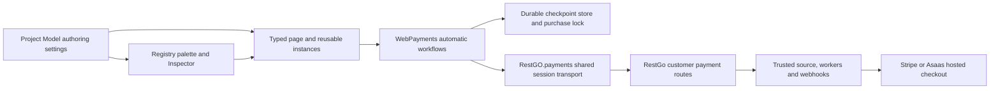

# RestGO Payments integration and automatic frontend flows

Status: implemented in source on 2026-11-07; validation pending. This document
records the delivered architecture and the remaining evidence. The initial
manual orchestration contract has been extended with automatic high-level flows;
the lower-level APIs remain compatible. See [Payments](payments.md) for usage.

No tests, builds, browser/Electron smokes, typecheck, lint, or formatting checks
were requested for this implementation. Required embedded source/declaration
regeneration is implementation work and does not establish runtime validation.

## Product contract

Normal authored page/reusable code starts checkout in one statement:

```typescript
await this.Payments1.Pay(this.Edit1.value);
```

`Pay` chooses one-time payment, `Subscribe` chooses subscription, and `Checkout`
uses the Inspector's mode. Their default behavior covers session restoration,
purchase-scoped recovery, idempotency preservation, checkout creation when needed,
waiting for an open URL, durable ID storage, and browser navigation. A recovered
already confirmed operation is returned without a new charge or redirect.

The component also provides `Resume`, `Refresh`, `LoadHistory`, `LoadMore`,
`CancelSubscription` with an optional explicit operation ID, and
`WaitForConfirmation`. High-level actions coordinate background observation;
normal callers do not manually compose checkpoints or stop/restart polls.

The automatic defaults are `autoResume: true`, `autoWatch: true`, and
`persistAttempts: true`. Automatic initialization or login restoration only reads
saved attempts, GETs a known operation ID, and observes it. It never POSTs a
checkout or navigates. An explicit `Resume` action can recover a lost creation
response by replaying the original saved attempt, without opening checkout.

## Existing backend boundary

The RestGo contract was inspected in the sibling checkout `C:\GitHub\RestGo`,
particularly `cmd/api/gateway_runtime.go`, `gateway_processor.go`,
`gateway_settings.go`, `gateway_lifecycle.go`, `asaas_processor.go`,
`stripe_checkout.go`, and `web/docs.html`.

| Customer route                                | Preserved contract                                                                     |
| --------------------------------------------- | -------------------------------------------------------------------------------------- |
| `POST /payment/{slug}/checkouts`              | Only `sourceKey`, `mode`, and UUID `idempotencyKey`; HTTP 202 is valid preparation.    |
| `GET /payment/{slug}/operations/{id}`         | Owner's current operation and optional open-checkout URL; HTTP 202 is valid.           |
| `GET /payment/{slug}/operations?before=...`   | `{ data, nextCursor }`, up to 50 records ordered by UUID; no checkout URLs in history. |
| `POST /payment/{slug}/operations/{id}/cancel` | Owner's subscription cancellation with normalized paid-period behavior.                |

All four routes use the customer's Authentication JWT. Provider and dashboard
credentials never enter component properties or generated browser requests. The
trusted application backend creates the purchase; RestGo reads price, currency,
ownership and recurrence from its source mapping. Source keys stay strings to
preserve PostgreSQL `int8` precision. Stripe and Asaas share this frontend contract.

Gateway setup, credentials, source mappings, webhook configuration, return URLs,
and required license activation remain in the RestGo dashboard. This frontend
integration adds no card-entry form, refund endpoint, billing portal, plan-change
API, direct provider SDK, or backend administrative operation.

## Architecture



`packages/restgo-sdk` owns session-only gateway transport methods, response guards,
and exported operation types. It preserves the existing `RestGoResult` and
`RestGoError` contracts, accepts successful HTTP 202, and retains the exact original
checkout body if session renewal retries a request. Lost network responses never
cause automatic creation with a different key.

`packages/runtime` owns the concrete nonvisual class, workflow coordination,
recovery storage, observation, state/events and browser navigation. Runtime
helpers remain independent of the Designer, Electron and Node.js. A browser-only
project-client lifecycle hook cancels obsolete work on connection replacement;
SDK authentication events clear cross-customer state. The runtime uses public
package exports and requires no new IPC/preload proxy.

The Component Registry owns the Nonvisual palette entry, Inspector defaults and
all 13 typed Interaction events. The strict format-v2 authoring schema persists
only gateway/mode/behavior settings. Live operation/checkpoint/request state and
runtime storage adapters are excluded. Generic page/reusable generation creates
and disposes concrete `WebPayments` instances, preserving stable IDs, reusable
placement isolation, lexical shadowing, and bare/`this` member access.

The public class/options/event APIs, SDK declarations and embedded browser
sources are synchronized through `scripts/sync-runtime-sources.mjs`; compiler
RestGo dependency selection includes `WebPayments`. Monaco exposes the actual
typed API, with no component global or `any` substitute.

## Recovery, concurrency and lifecycle decisions

- Default recovery uses browser `localStorage` and purchase-scoped Web Locks, or
  a runtime-only `WebPaymentsStorageAdapter` with equivalent durable storage and
  optional custom locking. Adapter methods are `getItem`, `setItem`, `removeItem`,
  and optional `withLock<T>(name, action, signal?)`. Missing custom locking falls
  back to required browser Web Locks, not uncoordinated writes.
- Versioned attempt keys are scoped to API URL, gateway, customer, source key,
  and mode. A separately scoped recent pointer supports one-call return recovery.
  Save the attempt before POST and save its returned operation ID before opening
  checkout; verify storage readback. Store no authentication/provider secrets or
  temporary checkout URL.
- Invalid saved data is rejected and preserved. Unavailable durable storage or
  locking fails clearly before a charge; no silent memory fallback or automatic
  replacement key is allowed. `persistAttempts: false` explicitly opts advanced
  callers into nondurable operation and application-owned recovery.
- A high-level workflow owns the entire asynchronous sequence. Matching concurrent
  calls share its promise; conflicting actions cannot interleave. Purchase locks
  coordinate the same source across participating instances/tabs. Check context
  and cancellation before every side effect, including navigation.
- Changing local selection preserves other durable attempts. `Clear` clears
  instance work/state without deleting stored attempts or canceling a remote
  transaction. Logout, customer change, disposal and client replacement abort old
  work and suppress late response application/navigation.
- Foreground refresh, history and cancellation coordinate automatic watching
  internally. Polling is serialized, bounded by deadline, honors `Retry-After`,
  and uses bounded transient-read backoff. Timeout/abort remains a local outcome.

## Financial state and simplified authoring

`checkoutState`, financial `status`, and source synchronization markers remain
distinct. Checkout creation `completed` and requested browser navigation are not
financial confirmation. Unknown future statuses remain visible without a success
assumption. Confirmation helpers understand one-time payment success and
subscription activation; waiting for database synchronization is separately
optional and synchronization failure is distinct from payment failure.

Convenience getters expose local state/busy/watching, selected financial and
checkout status, synchronization, action availability, and accumulated history
with cursor/hasMore. `LoadMore` deduplicates by operation ID and is a harmless
no-op after the final page. Loading history never changes selection.

Events cover payment success, subscription activation/cancellation, checkout
accepted/ready/opened, operation/synchronization/history/state changes, recovery,
errors and request completion. The default Interaction is `OnPaymentSucceeded`.
Cancellation events carry provider scheduling/paid-period fields; they do not
mean a refund. Events do not promise exactly-once delivery across reloads/devices,
and backend fulfillment remains authoritative.

Advanced `PrepareCheckout`, `CreateCheckout`, `WaitForCheckout`, `OpenCheckout`,
`GetOperation`, `ListOperations`, explicit watching and checkpoint APIs remain.
Manual `CreateCheckout` does not acquire the high-level automatic-opening behavior;
the concise `Pay` / `Subscribe` / `Checkout` API owns that orchestration.

## Navigation and deployment limits

The default checkout action uses same-context HTTPS navigation and avoids relying
on popup activation after asynchronous preparation. `openCheckout: false` exposes
a ready checkout for custom authored UI. Automatic recovery never redirects to
the provider again, preventing return loops.

RestGo saves fixed HTTP(S) success/cancel destinations without URL fragments.
The checkout POST cannot override them. A hosted return page queries RestGo;
redirect parameters are never payment proof. Preview/F9 uses changing loopback
publication addresses, so a fixed gateway URL does not automatically reopen that
Preview. Provider framing/browser restrictions also apply. Native custom-scheme
returns require a separate backend/platform contract.

Current history omits `sourceKey`; cross-device purchase lookup needs a durable
application-owned association, or a separately designed owner-scoped backend API.
Gateway discovery, per-attempt return destinations, refunds and provider-specific
billing operations remain separate extensions. The four-route frontend workflow
requires no additional backend endpoint.

## Verification evidence pending explicit request

Existing enumeration/type fixtures and Electron smoke interactions must track the
delivered public contract. The implementation does not by itself establish that
those interactions passed or that a deployed gateway is correctly configured.

| Area                | Evidence when the corresponding validation/coverage scope is requested                                                                                                                                                 |
| ------------------- | ---------------------------------------------------------------------------------------------------------------------------------------------------------------------------------------------------------------------- |
| SDK                 | Exact four routes, customer-only credentials, 200/202, response guards, pagination, original-key renewal, abort, HTTP/network errors.                                                                                  |
| Automatic workflows | One-call checkout opening, already-settled recovery, lost-response replay with original key, storage-before-POST/navigation, same-action coalescing, cross-instance locking, cancellation/context cleanup.             |
| Read/return flows   | Automatic restore performs only reads, explicit lost-ID replay, Refresh never creates, foreground actions coordinate observation, confirmation versus synchronization, accumulated history and no-more-pages behavior. |
| Authoring/language  | True automatic defaults, all 13 typed events, strict authoring-only serialization, stable IDs, concrete page/reusable members, Monaco completion/invalid-use diagnostics, lexical and placement isolation.             |
| Compiled Preview    | Real generated execution and updated existing Electron interactions against controlled HTTP fixtures, retaining deadlines and fatal renderer-error rules.                                                              |
| Live sandbox        | Deliberate Stripe/Asaas checkout, hosted return, webhook confirmation, synchronization and normalized cancellation/paid-period behavior. Fixtures alone cannot establish these results.                                |

Ordinary smokes must not create real provider charges. Reading gateway routes,
including polls/errors, currently cancels scheduled deletion during RestGo's grace
period; the Designer performs no payment polling. A source inspection cannot
certify deployed migrations, CORS, license readiness, provider credentials or
webhook delivery.
